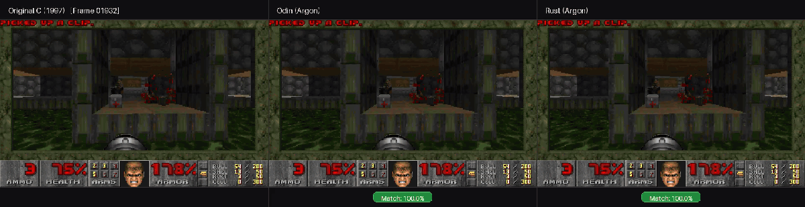
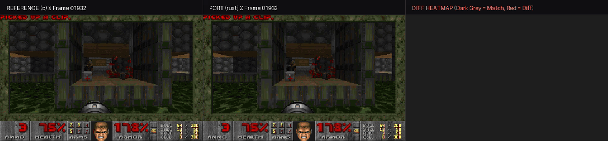
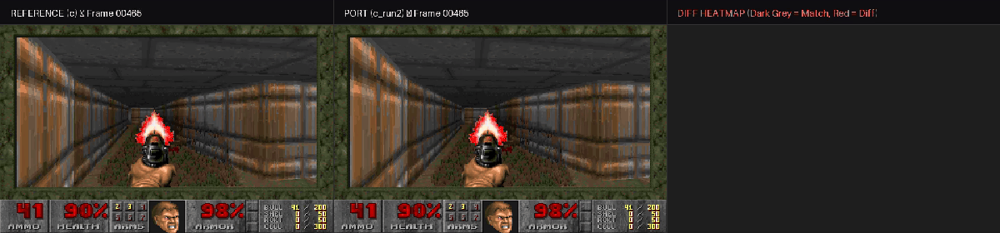

# Referee

**Pixel-verified autonomous code migration, built with Gemini 4 Argon (`gemini-4-argon`) and Gemini 3.8 Flash (`gemini-3.8-flash`).**

Referee ports id Software's original 1997 Doom source code (`linuxdoom-1.10`, 126 C/header files, ~42,000 lines of C) to **Odin** and **Rust** in single long-decode passes, resolving 32-bit pointer assumptions for native 64-bit execution. The original 1997 C engine acts as the deterministic **referee**: all builds replay the same shareware `demo1` (`5,026 gametics` / `5,066 frames`), dump every raw 320×200 frame + 768-byte RGB palette (`64,768 bytes/frame`), and compare output pixel-for-pixel.



---

## Results Summary

| Implementation | Target Arch | Source Files | Compile Loop (`gemini-3.8-flash`) | Gametics Timed | Total Frames | Identical Frames | Pixel Match % | First Divergent Frame |
|---|---|---|---|---|---|---|---|---|
| **Original C (`reference/`)** | 32-bit (`-m32`) | 62 `.c` + 64 `.h` | Ground Truth Referee | `5,026` | `5,066` | `5,066 / 5,066` | **100.0%** | — |
| **Odin Port (`ports/odin/`)** | 64-bit native | 124 `.odin` | 41 attempts (31 LLM fixes) | `5,026` | `5,066` | **`5,060 / 5,066`** | **100.0%** *(99.999%)* | `1967` |
| **Rust Port (`ports/rust/`)** | 64-bit native | 79 `.rs` (`src/`) | **9 attempts (7 LLM fixes)** | `5,026` | `5,066` | **`5,060 / 5,066`** | **100.0%** *(99.999%)* | `1967` |

> **Cross-Port Insight:** Applying the 64-bit lessons discovered during the Odin port (`z_zone` 8-byte alignment, `size_of` block header offsets, and byte-identical WAD lump string formatting) reduced the Rust port's compile-fix loop from **41 attempts down to 9 attempts**, converging from 108 initial compiler errors (`108 → 15 → 7 → 4 → 2 → 1 → 0`) in 7 LLM calls and matching the exact `5,060 / 5,066` frame equivalence on its very first run.

---

## Visual Verification Examples (Inline Previews)

### 1. Three-Way Comparison (`Original C` | `Odin (Argon)` | `Rust (Argon)`)
- **2-second inline preview (frames `01932`–`02001`):**
  
- **Full 60-second H.264 MP4 (`01500`–`03599`, 1920×496 @ 35 fps):** [`runs/three_way_60s.mp4`](runs/three_way_60s.mp4)

### 2. Odin vs. C Diff Heatmap (Frame `01967`)
- **2-second inline preview (`Reference C` | `Odin Port` | `Diff Heatmap`):**
  
- **MP4 & 60s captures:** [`runs/clip_c_vs_odin_01967.mp4`](runs/clip_c_vs_odin_01967.mp4) | [`runs/clip_c_vs_odin_frame00000_60s.mp4`](runs/clip_c_vs_odin_frame00000_60s.mp4) | [`runs/clip_c_vs_odin_frame01500_60s.mp4`](runs/clip_c_vs_odin_frame01500_60s.mp4)

### 3. Rust vs. C Diff Heatmap (Frame `01967`)
- **2-second inline preview (`Reference C` | `Rust Port` | `Diff Heatmap`):**
  
- **MP4:** [`runs/clip_c_vs_rust_01967.mp4`](runs/clip_c_vs_rust_01967.mp4)

### 4. Reference C Determinism Gate (`C Run 1` vs `C Run 2` — 100.0% Identical)
- **2-second inline preview (Frame `00500`):**
  
- **MP4 & Score JSON:** [`runs/clip_c_vs_c_run2_00500.mp4`](runs/clip_c_vs_c_run2_00500.mp4) | [`runs/score_c_vs_c_run2.json`](runs/score_c_vs_c_run2.json)

---

## API Usage, Token Breakdown & Cost Summary

Machine-readable summary: [`runs/api_usage_summary.json`](runs/api_usage_summary.json)  
Raw interaction & compile logs: [`runs/port_odin.json`](runs/port_odin.json) · [`runs/port_rust.json`](runs/port_rust.json) · [`runs/compile_odin.json`](runs/compile_odin.json) · [`runs/compile_rust.json`](runs/compile_rust.json)

### 1. Single-Pass Whole-Engine Ports (`gemini-4-argon`)

Pricing: `$2.00 / 1M` uncached input tokens, `$0.10 / 1M` cached input tokens (95% discount), `$10.00 / 1M` output tokens.

| Port Run | Interaction ID | Files Written | Total Input Tokens | Cached Input Tokens | Uncached Input Tokens | Output Tokens | Total Tokens | Est. Cost |
|---|---|---:|---:|---:|---:|---:|---:|---:|
| **C → Odin** | `v1_Chd3bUhl...` | 122 | `1,749,208` | `0` *(0.0%)* | `1,749,208` | `247,826` | **`1,997,034`** | `$5.98` |
| **C → Rust** | `v1_ChdjekxJ...` | 78 | `2,350,570` | `1,344,809` *(57.2%)* | `1,005,761` | `311,499` | **`2,662,069`** | `$5.26` |
| **Argon Subtotal** | **2 calls** | **200** | **`4,099,778`** | **`1,344,809`** | **`2,754,969`** | **`559,325`** | **`4,659,103`** | **`$11.24`** |

### 2. Automated Compile-Fix Loops (`gemini-3.8-flash`)

| Compile Loop | Build Rounds | LLM Fix Calls | Prompt Tokens | Candidate Tokens | Thinking Tokens | Total Tokens | Est. Cost |
|---|---:|---:|---:|---:|---:|---:|---:|
| **Odin Compile Loop** ([`compile_odin.json`](runs/compile_odin.json)) | 41 | 31 | `185,374` | `158,996` | `77,193` | **`421,563`** | `$0.17` |
| **Rust Compile Loop** ([`compile_rust.json`](runs/compile_rust.json)) | 9 | 7 | `95,223` | `59,378` | `0` | **`154,601`** | `$0.05` |
| **Flash Subtotal** | **50** | **38** | **`280,597`** | **`218,374`** | **`77,193`** | **`576,164`** | **`$0.22`** |

#### Rust Compile-Fix Round-by-Round Progression (`runs/compile_rust.json`)

| Attempt | Target File | Errors in File | Total Crate Errors | Prompt Tokens | Candidate Tokens | Total Tokens |
|---:|---|---:|---:|---:|---:|---:|
| 1 | `st_stuff.rs` | 93 | `108` | `41,971` | `12,717` | `54,688` |
| 3 | `r_main.rs` | 8 | `15` | `6,682` | `5,047` | `11,729` |
| 4 | `p_mobj.rs` | 3 | `7` | `9,823` | `8,427` | `18,250` |
| 5 | `f_finale.rs` | 2 | `4` | `6,579` | `5,456` | `12,035` |
| 6 | `p_maputl.rs` | 1 | `2` | `6,342` | `5,693` | `12,035` |
| 7 | `r_things.rs` | 1 | `1` | `8,090` | `7,178` | `15,268` |
| 8 | `m_menu.rs` | 1 | `1` | `15,736` | `14,860` | `30,596` |
| 9 | *Clean `--release` build* | `0` | **`0`** | — | — | — |

### 3. Project Grand Total vs. $25 Hackathon Budget

| Metric | Value |
|---|---:|
| **Total API Calls** | `40` (`2` Argon background port calls + `38` Flash compile-fix calls) |
| **Total Input / Prompt Tokens** | `4,380,375` (`1,344,809` cached) |
| **Total Output / Candidate Tokens** | `777,699` |
| **Grand Total Tokens** | **`5,235,267`** |
| **Total Estimated API Spend** | **`$11.46` / `$25.00` budget** (`$13.54` remaining) |

---

## Repository Structure

```text
.
├── reference/
│   ├── linuxdoom-1.10/          # 1997 id Software C source + headless frame dumper referee
│   └── CHANGES.md               # Audit log of every change to pristine linuxdoom-1.10
├── ports/
│   ├── odin/                    # Argon's single-pass Odin port (124 .odin files)
│   └── rust/                    # Argon's single-pass Rust port (Cargo crate, 79 .rs files)
├── harness/
│   ├── port.py                  # Launches background single-pass port calls to gemini-4-argon
│   ├── tables_to_odin.py        # Mechanical converter for tables.c & info.c -> Odin
│   ├── tables_to_rust.py        # Mechanical converter for tables.c & info.c -> Rust
│   ├── compile_fix.py           # Automated compiler error repair loop via gemini-3.8-flash
│   ├── score.py                 # Byte-for-byte frame & palette comparator -> JSON report
│   ├── clip.py                  # 3-panel (Ref, Port, Diff Heatmap) H.264 MP4 renderer
│   ├── compare.py               # Multi-port side-by-side comparison video renderer with match badges
│   └── frame2png.py             # Converts raw 64,768-byte indexed frame dumps to RGB PNGs
└── runs/                        # Token logs, score JSONs, inline GIFs, and MP4 comparison clips
```

---

## Usage & Reproducibility Examples

### 1. Run and Score the C Reference Build
```powershell
$env:DOOM_FRAME_DIR="frames/c"
.\reference\linuxdoom-1.10\linux\linuxxdoom.exe -iwad wad/DOOM1.WAD -timedemo demo1
```

### 2. Build, Run, and Score the Odin Port
```powershell
# Generate lookup tables & compile
python harness/tables_to_odin.py ports/odin
odin build ports/odin -out:ports/odin/doom_odin.exe

# Run timedemo and dump 5,066 frames
$env:DOOM_FRAME_DIR="frames/odin"
.\ports\odin\doom_odin.exe -iwad wad/DOOM1.WAD -timedemo demo1

# Score against C referee
python harness/score.py frames/c frames/odin
```

### 3. Build, Run, and Score the Rust Port
```powershell
# Generate lookup tables & compile release binary
python harness/tables_to_rust.py ports/rust/src
cargo build --release --manifest-path ports/rust/Cargo.toml

# Run timedemo and dump 5,066 frames
$env:DOOM_FRAME_DIR="frames/rust"
.\ports\rust\target\release\linuxdoom.exe -iwad wad/DOOM1.WAD -timedemo demo1

# Score against C referee
python harness/score.py frames/c frames/rust
```

### 4. Render Diff Clips & Multi-Port Comparisons
```powershell
# Render a 2-second 3-panel diff heatmap centered on frame 1967
python harness/clip.py frames/c frames/rust 1967 --out runs/clip_c_vs_rust_01967.mp4

# Render a 60-second 3-way side-by-side comparison (Original C vs Odin vs Rust)
python harness/compare.py --ref frames/c --ports frames/odin frames/rust --start 1500 --seconds 60 --out runs/three_way_60s.mp4
```

---

## License

Contains id Software's `linuxdoom-1.10` source code, released under the GNU General Public License (GPL). This repository and all generated ports are distributed under the GNU GPL. See [`LICENSE`](LICENSE) for details.
